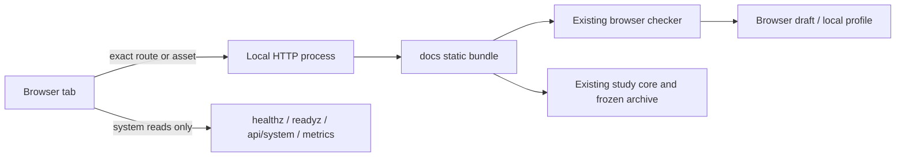

# CueReport architecture and Phase 2 proposal

## Running system

CueReport is a static browser application that can be served from GitHub Pages or the local hardened HTTP serving process. `scripts/build.js` combines the HTML/CSS/JavaScript in `src/` with repository data and cached results into `docs/index.html`. The optional local server provides private SQLite saved work, durable Beaker guest/account sessions, Argon2 password verification, logical workspace snapshots, process health and HTTP metrics. It provides no model API, hosted queue or deployed AWS service. Retained browser profiles are explicitly separate from server accounts.

The browser runs the deterministic report checker in `src/checker.js`. Its seven composer rows are steps, screen-reader steps when relevant, app version, device/Android version, expected versus actual behavior, screen or element, and optional screen-reader settings. The separate research ablation checklist has six measured features; these counts must not be conflated.

The public study dataset contains 75 GitHub issues. The current clean cached run contains 53 eligible reports and 187 model answers. These are saved study artifacts, not a live model service or a measurement of accuracy. The cached model setting is recorded as “quick”; the exact model version was not exposed by that runtime. Human labels remain incomplete.

The browser can import a public GitHub issue only after a user action. It calls `api.github.com` directly, without CueReport credentials, times out after 10 seconds, and limits the response to 256 KiB. Imported text stays in the browser until explicit Save current run uploads it to the owned server workspace. Current tab recovery is principal-scoped on server hosts; retained old browser/encrypted copies require explicit import. Private report bodies are excluded from share and GitHub URLs; users copy/download Markdown and open the bare GitHub issue form to paste and review it.

Live Claude access in the page exists only when the page runs in the Claude app runtime. The command-line runner can use a user-supplied API key. Neither is part of a deployed CueReport backend; the cached research results remain available without either engine.

## Phase 2 proposal (not deployed)

The proposed QA workflow is:

```text
Public GitHub issue
        │ user-selected, bounded import
        ▼
CueReport report composer ── deterministic completeness check
        │                                  │
        │ optional future request          └── local draft / public issue draft
        ▼
AWS Step Functions (proposed orchestration)
        │
        ├── Amazon Bedrock (proposed model adapter)
        └── Human review queue (proposed; approve, edit, or reject)
```

The diagram describes a design direction only. Step Functions, Bedrock, the queue, persistence, user authentication, team permissions, audit events, and a backend API are not implemented or deployed. No report is currently sent to AWS. Any future model result must remain visibly separate from deterministic completeness findings and require a human decision before public feedback is posted.

### Proposed integration boundaries

- GitHub issue text is untrusted input. A future backend would need authenticated authorization, request-size limits, per-repository access checks, idempotency, rate controls, and explicit data retention before accepting it.
- Model prompts and versions must be pinned and recorded for each run. A cached result cannot be relabelled as a fresh inference.
- Human reviewers must be able to edit or reject a suggestion. The system must not invent confidence or treat completeness as correctness.
- Credentials belong in a backend secret store. The static app must not receive AWS credentials or retain a BYOK secret in local storage, URLs, logs, or analytics.
- Public comments, labels, or issue creation require a separate user action and explicit repository permissions. A private report must not be sent to a public issue form by default.

## Constraints

The current service is a report-preparation aid, not triage automation. It has no service-level agreement, response-time guarantee, security certification, or measured accuracy claim. Existing third-party issue text remains subject to its authors' rights and GitHub context; the code's MIT licence does not relicense those reports.

## Editorial entry and local saved drafts

The root now opens the product entry. `#/login` and `#/signup` manage optional local profiles; `#/saved` and `#/profile` show saved work. `#/app` opens the report screen; `/app/check`, `/app/draft`, `/app/examples`, `/app/research`, `/app/research/labels` and `/app/research/methods` alias the existing hash routes. Legacy explicit report/share/study routes retain their meaning. All tools remain free and guest accessible.

Canonical `src/product.js`, `src/product.css` and `src/local-profile.js` are included by the existing single-file build and its script-hash CSP. No framework or backend is added. Product navigation uses native disclosures; preview selection has manual controls, persistent pause, focus/hover pause and reduced-motion handling. The report adapter captures explicit bounded text and resets volatile state on identity changes. Password hashing does not encrypt reports; see SECURITY.md for the browser-local trust boundary.

## Portable work and optional cloud reference

`encrypted-backup.js` and `backup-ui.js` export explicitly saved drafts, validate app/version/structure before restore, and require a new-profile or merge confirmation. Unsaved editor text and session credentials are excluded. Cancellation and quota failure preserve existing work. See ENCRYPTED_BACKUP.md.

`sync-provider.js` and `sync-ui.js` implement an explicit Supabase Auth/RLS connector with owner-derived authorization, conditional revisions, conflict review and deletion tombstones. It ships unconfigured; no hosted project or live cross-device sync was verified. See CLOUD_SYNC.md for schema and configuration boundaries. Neither browser-local namespacing nor password verification isolates apps sharing an origin.

Platform-specific report rules live separately in `platform-checks.js`; the original Android research checker/data/results are preserved. CSV/JSON imports are memory-only bounded local collections. The bot view is a deterministic preview with no repository write, installed workflow or token collection.

## Direct routes and observability



The server route allowlist must return HTML only for `/`, `/ablation`, `/statistics`, and `/system`; unknown API and asset paths remain 404. Legacy hash navigation stays client side and Pages-compatible. Direct root queries contain public report IDs; pasted report sharing always uses the URL fragment. Each tab owns its route and current editor state; existing local saved drafts remain explicitly shared browser storage.

The System page performs four bounded five-second GET requests. Endpoint failures remain visible with Refresh; it does not assume health. Prometheus data measures the serving process, not browser checker execution, research validity, historical workload, or model performance. The archived run lacks an exact model version and prompt revision, so its condition comparisons cannot support a controlled cross-model comparison. No AWS service was added for these routes.


## Implemented private server mode

Four product routes (`/overview`, `/workbench`, `/reports`, `/settings`) expose actual workflows and stored evidence. Optional server persistence uses SQLite WAL on a private UID10001 volume, opaque durable Beaker sessions and Argon2 accounts. Origin/CSRF/owner checks, quotas and idempotent saves are enforced by the server. No reconnect upload, private signing-key storage or private API caching occurs. Snapshots stay on the same local volume; they are not an independent device backup. See [server workspaces](SERVER_WORKSPACES.md) for contracts, launch, limits and recovery. AWS diagrams elsewhere remain proposals.
