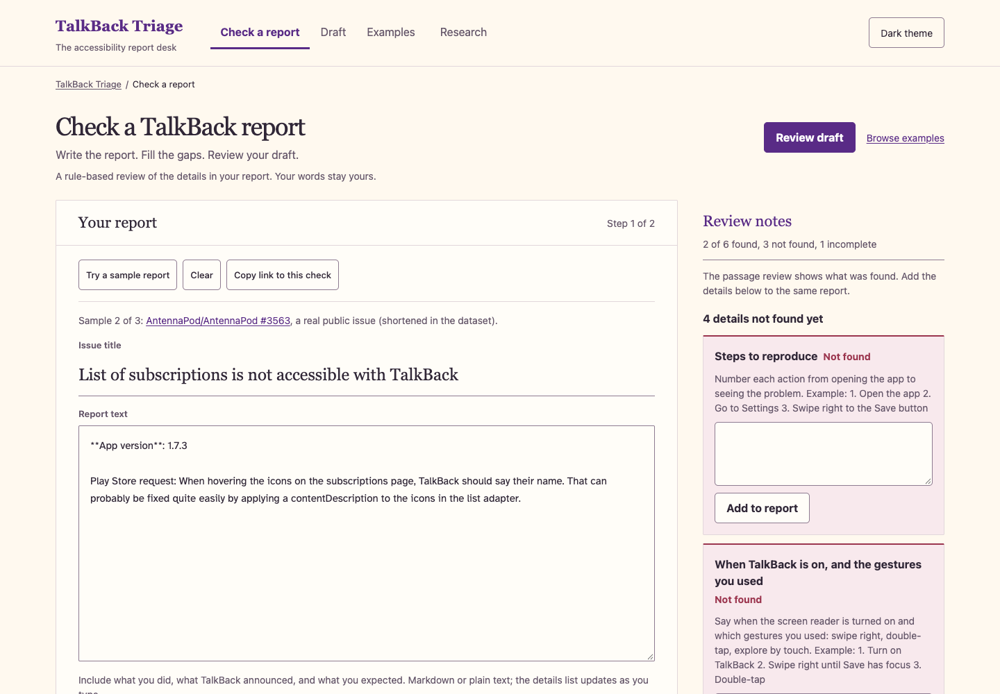

# TalkBack Triage Pilot

**A report checker for Android accessibility bug reports, and the small pilot study behind it.**

Paste a bug report and the checker lists which of seven details it can find: steps, TalkBack or screen-reader steps, app version, device and Android version, expected vs. actual behavior, the screen or element, and screen-reader settings. It then gives you the report rewritten with `[ADD: ...]` where something was not found. It is a heuristic completeness check (rules, not AI), runs in your browser, and works offline once loaded.

**Try it:** open https://anirudh763.github.io/talkback-triage-pilot/ and press **Try a sample report**, or paste your own. Limits: it finds missing sections only, and it has no user validation. See [What it is not](#what-it-is-not).

**Status: public beta**, maintained by one student on a best-effort basis. The supported task is narrow: before you file or triage an Android accessibility bug, check one report for missing sections and copy the rewritten version. The checker has not been tried with real reporters or triagers. Security reports: see [SECURITY.md](SECURITY.md) (through GitHub, not email).

Below the checker, this repository holds an exploratory study: does removing TalkBack steps or the app version from 75 real issues change how an AI triages them? See [The study](#the-study).

## Contents

- [Report checker](#report-checker)
- [Use it in your own repo](#use-it-in-your-own-repo)
- [The study](#the-study): [why](#why-this-matters), [questions](#research-questions), [how it works](#how-the-pilot-works), [results](#results-so-far), [labelling](#labelling-reports), [limitations](#limitations)
- [What is in this repository](#what-is-in-this-repository) and [quick start](#quick-start)
- [Related work](#related-work)
- [Citing, licence and credits](#citing-licence-and-credits)

## Report checker



The [live app](https://anirudh763.github.io/talkback-triage-pilot/) checks one bug report for missing sections: steps, versions, device, expected and actual behavior, and where in the app. It opens on **Check a report** (`#/check`) with a real, incomplete issue from the dataset; press **Try a sample report** for another, or paste your own.

Check is a report composer: the report text beside a plain Markdown preview of the issue body (headings, lists, quotes, code and bold; other Markdown shows as text). Text the checker matched is highlighted where it appears. Each detail it did not find becomes a prompt where you type it in your own words and **Add to report**; the report is then checked again. Nothing is filled in for you. Each detail is also listed as Found, Incomplete, Not found, Optional or Not needed, in text and with an icon.

**Review draft** (`#/draft`) opens the draft on its own screen: your report rearranged under the headings a developer looks for, with what to add marked `[ADD: ...]`, ready to copy or download as Markdown. **Examples** (`#/examples`) lists the 75 dataset reports with filters (app, a detail not found, title text); each opens in Check and links to its GitHub issue. The study is under **Research** (`#/research`, `#/research/labels`, `#/research/methods`). The page is light by default, including when your system prefers dark; **Dark theme** in the menu switches and is remembered. Old links (`#check?report=…`, `#pilot`, `#label`, `#about`) still work.

| Detail | What counts |
|---|---|
| Steps to reproduce | A numbered or bulleted list, or a "Steps" section with text in it |
| TalkBack or screen-reader steps | The steps say when TalkBack or another screen reader is on. Optional when no screen reader is mentioned; not needed for font-size, contrast and similar reports |
| App version | `App version: 3.1.0`, `App version: 42`, `JPAndroid 24.8`. A TalkBack, Android or other component version never counts |
| Device and Android version | `Pixel 8`, `Nexus 6P`, `Android 14`, `API 34`; one of the two is "Incomplete" |
| Expected vs. actual behavior | Both described; a quoted announcement counts as "actual" |
| Screen or element | `the Post list screen`, `Go to "My Site"`, `Settings > Accessibility` |
| Screen-reader settings (optional) | `TalkBack 15.0`, speech rate, verbosity, font size |

Empty template sections, HTML comments and unfilled placeholders such as `_No response_`, `[device]`, `[e.g. Pixel 8]`, `N/A` or GitHub's default "A clear and concise description of…" prompt don't count as content. Steps written on the label's own line (`Steps to reproduce: Open the app, swipe right twice, …`) count. The checker reads at most the first 64,000 characters of a report and says so when it cuts one.

### What it is not

It finds missing sections only. A report with every section is not necessarily reproducible or ready to act on: [AntennaPod #6598](https://github.com/AntennaPod/AntennaPod/issues/6598) had the app version, Android version, device and numbered TalkBack steps, and still took 8 comments of follow-up and was labelled "Needs: Upstream fix" before it was closed. No interviews or user studies have been done with people who file or triage reports, so the checker has no user validation. It is a heuristic completeness check (pattern rules in `src/checker.js`, not AI). It can miss a detail written in an unusual way or count a phrase that only looks like one. It says nothing about whether the AI triage in the study is right, and it doesn't use the AI.

### Privacy, offline use, accessibility and security

**Privacy.** The page's Content Security Policy lets it load only its own files and blocks requests to other sites; the browser test checks that such a request is refused. A dataset report has its own link (`#/check?report=WP-21127`). **Copy link to this check** puts the whole pasted report into the link after `#`. Browsers don't send that part to the server, but anyone who gets the link can read the report.

**Offline and install.** After one visit the page works without a network: a service worker keeps the page, its fonts and icons in a versioned cache. Online it always fetches the latest page first. It has a web app manifest and SVG and PNG icons, so browsers that support installing web apps can offer to install it; installing has not been tried by hand. The browser test turns the network off, reloads, and checks a sample. Without JavaScript the page shows a message pointing here.

**Accessibility.** Passes automated axe-core checks with 0 violations on every screen, at 1280, 375 and 320 px wide, in the default light theme and the opt-in dark theme. Playwright also checks keyboard-only use, focus moving to each screen's heading, the Menu sheet (Escape closes it and returns focus), Back/Forward keeping the report, 320/768/1440 px widths without sideways scrolling, 200% zoom, 24px minimum targets (controls are built at 44px) and error states. A manual screen-reader check has not been run.

**Security.** Checked with `npm audit` (0 vulnerabilities) and a manual review of every place the page shows pasted or dataset text and of the CI workflow; no high-severity findings. semgrep ran with the committed rule file `.semgrep/dom-sinks.yml` (HTML-string sinks: `innerHTML`, `outerHTML`, `insertAdjacentHTML`, `document.write`, `eval`, `new Function`, string `setTimeout`, `createContextualFragment`) over `src/`, `scripts/` and the page's inline scripts: 0 findings. Command: `node scripts/inline-scripts.js /tmp/app-inline.js && semgrep --metrics=off --config .semgrep/dom-sinks.yml /tmp/app-inline.js src scripts`. Its registry rule packs could not be downloaded in the environment used. Hardening: a Content Security Policy, data embedded in the page escapes every `<`, the CI workflow uses a read-only token and actions pinned to commit SHAs, and pasted text is only ever shown as text (tested).

## Use it in your own repo

[`examples/accessibility-bug.yml`](examples/accessibility-bug.yml) is a GitHub issue form that asks for the checker's seven details, with expected and actual behavior as two fields. Fields are required where the checker requires them; screen-reader settings are optional. To use it, copy the file to `.github/ISSUE_TEMPLATE/accessibility-bug.yml` in your repository:

```bash
mkdir -p .github/ISSUE_TEMPLATE
curl -fsSL -o .github/ISSUE_TEMPLATE/accessibility-bug.yml \
  https://raw.githubusercontent.com/anirudh763/talkback-triage-pilot/main/examples/accessibility-bug.yml
```

A test (`test/issue-form.test.js`) checks that the file parses, that its field ids map onto the checker's keys, and that an issue filled in with the form's example answers is read by the checker as having all seven details. It has not been tried on a real repository's issues yet.

<details>
<summary>The whole form</summary>

```yaml
# A GitHub issue form for Android accessibility bug reports.
# Copy this file to .github/ISSUE_TEMPLATE/accessibility-bug.yml in your own repository.
# Its fields are the seven details the TalkBack Triage Pilot report checker looks for:
# https://github.com/anirudh763/talkback-triage-pilot#report-checker
# (Expected and actual behavior are two fields here; the checker counts them as one detail.)
name: Accessibility bug
description: Something doesn't work with TalkBack, another screen reader, or an accessibility setting.
title: "[Accessibility]: "
labels: ["accessibility"]
body:
  - type: markdown
    attributes:
      value: |
        Thanks for reporting this. A developer who doesn't use a screen reader needs to repeat what you did, so please say which gestures you used and what was announced.
  - type: textarea
    id: steps
    attributes:
      label: Steps to reproduce
      description: Number each action, from opening the app to seeing the problem.
      placeholder: |
        1. Open the app and go to the Post list screen
        2. Swipe right until the three-dot menu button is focused
        3. Double-tap the menu button
    validations:
      required: true
  - type: textarea
    id: srSteps
    attributes:
      label: TalkBack or screen-reader steps
      description: Which screen reader you used, when it was turned on, and the gestures (swipe right, double-tap, explore by touch).
      placeholder: |
        1. Turn on TalkBack
        2. Swipe right to move focus to the three-dot menu button
        3. Double-tap to open the menu
    validations:
      required: true
  - type: input
    id: appVersion
    attributes:
      label: App version
      description: From the app's Settings > About screen.
      placeholder: "24.8"
    validations:
      required: true
  - type: input
    id: device
    attributes:
      label: Device and Android version
      description: The phone or tablet model and its Android version.
      placeholder: Pixel 8, Android 14
    validations:
      required: true
  - type: textarea
    id: expected
    attributes:
      label: Expected behavior
      description: What should happen.
      placeholder: TalkBack announces "More options, button" and the menu opens.
    validations:
      required: true
  - type: textarea
    id: actual
    attributes:
      label: Actual behavior
      description: What happens now. Quote what the screen reader announces.
      placeholder: TalkBack announces "Unlabeled button" and nothing happens on double-tap.
    validations:
      required: true
  - type: input
    id: where
    attributes:
      label: Screen or element
      description: The screen and the control, e.g. Post list > three-dot menu button.
      placeholder: Post list screen > three-dot menu button
    validations:
      required: true
  - type: textarea
    id: srSettings
    attributes:
      label: Screen-reader settings (if relevant)
      description: The TalkBack version and any non-default settings, such as speech rate, verbosity or font size, if they could matter.
      placeholder: TalkBack 15.0, speech rate 150%, verbosity high
    validations:
      required: false
```

</details>

## The study

**Do TalkBack reproduction steps and the app version in an Android accessibility bug report change how an AI triages it?**

A small, open pilot study and the web app that runs it. It uses 75 real accessibility issues from two open-source Android apps. Each report is triaged by an AI twice: once as filed, and once with its TalkBack steps or version details taken out. The two answers are then compared. People can label the same reports, so the AI's answers can be checked against human judgement.

**Status: exploratory.** One AI run, no human labels yet. Read the results as "the AI's answer depends on these lines". Whether its answers are *right* still needs labels from people. See [Limitations](#limitations).


## Why this matters

Blind and low-vision people use Android through screen readers such as TalkBack. When an app breaks for them, a developer first has to answer two questions:

1. Does this stop someone from finishing a task, or only slow them down?
2. Is there enough in the report to start reproducing it?

Accessibility reports are often hard to act on. A developer who doesn't use TalkBack may not know which gestures were used or what was announced. Earlier work has shown how to find which reports are about accessibility ([Aljedaani et al., W4A 2022](https://smilevo.github.io/access/)), and that Android reports often lack steps and environment details ([Johnson et al., 2022](https://arxiv.org/abs/2301.01235)). This pilot asks the next question: once a report is known to be about accessibility, which details let someone act on it? And can an AI help sort them?

## Research questions

- **RQ1.** Does removing TalkBack reproduction steps or the app version change an AI's answer to "Could a developer start reproducing this?" and "Does this block the task?"
- **RQ2.** How well do the AI's answers agree with people's answers on the same report and version?
- **RQ3.** Does the AI do better than a simple checklist rule ("enough to start reproducing when the report has steps")?

The saved run addresses RQ1. RQ2 and RQ3 need human labels. The labelling screen and `scripts/agreement.js` exist and pass automated tests, but no human labeller has used them yet, so the workflow is untested with people.

## What is in this repository

| Path | What it is |
|---|---|
| `docs/index.html` | The whole web app in one file, served by GitHub Pages. Built from `src/`. |
| `src/core.js` | All the logic, with no user interface: the parser, the checklist, the removal rules, the clean-copy check, the AI prompt, the answer parser and the statistics (Cohen's kappa, exact McNemar test). Shared by the app and the scripts. |
| `src/app.html` | The app's interface (template). |
| `data/` | The 75 GitHub issues as fetched (`raw_*.txt`), and parsed (`issues.json`). See [DATA.md](DATA.md). |
| `results/runs/<id>/` | Saved AI runs: `meta.json` plus one file of answers per report. |
| `results/pair_review.md` | Every line each shortened copy removes, for hand-checking. |
| `results/*.csv` | The runs as spreadsheets. |
| `labels/` | Where human label files go. See [LABELING.md](LABELING.md). |
| `scripts/` | Command-line tools (below). Node.js 18 or later, no dependencies. `scripts/icons.js` needs Playwright. |
| `test/core.test.js` | Checks the answer parser and the statistics against hand-worked values. No dependencies. |
| `test/e2e.js` | Browser test of the built app with a fake AI, including failed and refused AI replies. Uses Playwright. |
| `src/checker.js` | The report checker's rules and the rewritten-report template. No user interface, no network. |
| `src/ui.css`, `src/app.css` | Shared base styles and the app's own styles, inlined into `docs/index.html` by `scripts/build.js`. |
| `test/checker.test.js`, `test/checker.e2e.js`, `test/workflow.test.js` | Checker unit tests; browser test of the checker with the axe-core, keyboard, 320/375px and 200% zoom checks; CI workflow guards. |
| `examples/accessibility-bug.yml` | A GitHub issue form with the checker's seven details, to copy into another repository. |
| `src/sw.js`, `src/manifest.webmanifest`, `src/icon.svg` | Offline and install support: the service worker (built to `docs/sw.js` with the version), the web app manifest and the icon. `scripts/icons.js` renders the PNG icons from the SVG. |
| `test/offline.e2e.js`, `test/noscript.e2e.js`, `test/issue-form.test.js`, `test/version.test.js` | Offline reload, the no-JavaScript message, the issue form, and the version matching `CHANGELOG.md`. |
| `test/routes.e2e.js` | The routed UI: each screen's heading, title and focus, the Menu sheet, Back/Forward and deep links keeping the report and filters, old links, light by default, the report composer's highlights and gap prompts, and axe-core in light and dark at 1280 and 320 px. |
| `AGENTS.md`, `CLAUDE.md`, `DESIGN.md` | Notes for coding agents, and the app's design standard. |
| `assets/`, `docs/screenshots/` | Screenshots for this README. |

## Quick start

**Just look at it:** open the [live app](https://anirudh763.github.io/talkback-triage-pilot/), or open `docs/index.html` in a browser. The report checker, the saved results and labelling need no server; on the live site they keep working offline after the first visit. Asking the AI live only works when the page runs inside the Claude app (see [AI triage](#4-ai-triage)).

**Run the checks and rebuild** (needs [Node.js](https://nodejs.org) 18+):

```bash
git clone https://github.com/anirudh763/talkback-triage-pilot.git
cd talkback-triage-pilot

node scripts/check.js                  # checklist flags for every report; fails if any shortened copy isn't clean
node scripts/show-copy.js WP-20770     # a report as filed and each shortened copy
node scripts/pair-review.js            # rewrite results/pair_review.md
node scripts/analyze.js                # numbers for the latest clean run (add --csv to export)
node scripts/build.js                  # rebuild docs/index.html after changing src/, data/ or results/
```

**Rerun the AI triage with your own API key:**

```bash
export ANTHROPIC_API_KEY=sk-ant-...
node scripts/run-triage.mjs --model claude-haiku-5-5 --limit 5    # a quick trial on 5 reports
node scripts/run-triage.mjs --model claude-haiku-5-5              # the full pilot (187 calls)
node scripts/analyze.js <run id printed above>
```

The script uses the same prompt and the same clean-copy rule as the app. It saves the run in the same format, so `analyze.js` and the app can read it. Reusing `--id` finishes an interrupted run.

**Compare labels:**

```bash
node scripts/agreement.js labels/rater-a.json labels/rater-b.json
```

## How the pilot works

### 1. Data
Public GitHub issues, fetched on 9 November 2026:
- WordPress for Android: 51 issues labelled `Accessibility` that mention TalkBack or a screen reader.
- AntennaPod: all 24 issues labelled `Area: Accessibility`.

This is an accessibility-issue sample, not only bug reports: by their GitHub type labels, 24 are bugs or crashes, 29 are feature requests or enhancements (for example [AntennaPod #8145](https://github.com/AntennaPod/AntennaPod/issues/8145), an accessibility concern labelled "Type: Feature request"), 1 is a task and 21 have no type label.

Images and videos become `[image]` and `[video]`, template checklists are dropped, and long bodies are cut at about 1,200 characters. Full details are in [DATA.md](DATA.md).

### 2. Checklist
Deterministic text rules (`check()` in `src/core.js`) flag six details in each report:

| Detail | Example of what counts |
|---|---|
| TalkBack reproduction steps | Ordered steps that say how TalkBack was used |
| App version or build | `3.1.0`, `JPAndroid 24.8` |
| Android version or device | `Android 12`, `API 24`, `Pixel 8`, an emulator |
| Expected vs. actual behaviour | Both are described |
| What TalkBack said | A quoted announcement, e.g. reads as "Button" |
| Recording or screenshot | An attached image or video |

How often each detail appears:

| Detail | WordPress (51) | AntennaPod (24) |
|---|---|---|
| TalkBack reproduction steps | 55% | 17% |
| App version or build | 35% | 96% |
| Android version or device | 51% | 46% |

### 3. Controlled copies
For each report that has the details, the pilot makes shortened copies:

- **TalkBack steps removed.** Drops only the *action* steps: the steps heading and the list items under it. It keeps:
  - steps that report what happened (for example "Notice it crashes")
  - anything TalkBack said
  - recordings, notes and workarounds
  - "Tested on" lines
- **App version & device removed.** Drops the app version, Android version, device and where the app came from. It keeps "first occurred" notes.
- **Both removed.**

Nothing marks where text was cut. A copy is used only if the checklist confirms that the target detail is gone and **every other detail it measures is unchanged** (`pairCheck()`). All 134 copies pass this check. The check is automated: it confirms that the other measured details are still there, not that a copy differs from the original only in the removed detail. Two known cases: WordPress-Android #21127's copy without steps keeps a sentence that describes how to reproduce the bug, and AntennaPod #8145's copy drops a step that reports what happened ("Screens auto advance without a next/previous"). Every removed line is listed in [`results/pair_review.md`](results/pair_review.md), and the app shows each removal struck through.


### 4. AI triage
Each version goes to the model in its own call, with the same fixed instructions (`prompt()` in `src/core.js`). The model answers:

- **evidence**: could a developer start reproducing this issue with the information here? (`actionable` or `needs_more_evidence`)
- **task_impact**: for a TalkBack user, does it block the task, slow it, is it minor, or can't it tell?
- **missing**: which of the six details are missing.
- **reason** and **ask_reporter**: one sentence each.

No self-reported confidence is collected, because a model's stated confidence isn't calibrated.

The saved run used Claude (Anthropic) through the Claude app's artifact runtime with its "quick" model setting. That runtime doesn't report the exact model version. `scripts/run-triage.mjs` lets anyone rerun with a named model through the API.

### 5. Analysis
- **Change from as-filed.** For each shortened version, how many reports changed answer, in each direction. Tested with an exact McNemar test on the paired answers.
- **Manipulation check.** Does the model flag the removed detail as missing?
- **Agreement with people** (RQ2): percent agreement and Cohen's kappa. Each version is compared only with labels of that same version.
- **Baseline** (RQ3): the same agreement for the checklist rule.

## Results so far

Run `rmw9sfcx9`, 9 November 2026: 53 reports, 187 AI answers, quick model setting, one run.

| Version vs. as filed | Switched to "needs more evidence" | Switched the other way | Exact McNemar |
|---|---|---|---|
| Only TalkBack steps removed | 12 of 32 | 1 | p = 0.003 |
| Only app version & device removed | 2 of 49 | 0 | p = 0.50 |
| Both removed | 18 of 53 | 0 | p < 0.001 |

- The model's **"blocks the task"** answer changed on only 6–9% of reports. In this run, the steps affected "can a developer start reproducing it", not "how bad is it".
- With the steps removed, the model flagged TalkBack steps as missing on 25 of 32 reports. It did so on 1 of 32 when the steps were present.
- **Most of the effect comes from WordPress for Android**: 10 of 28 switched. Only 4 AntennaPod reports had TalkBack steps, too few to say anything about that app.
- An earlier run (`rmw9qhkle`, kept in `results/` and marked superseded) used removal rules that sometimes also cut the device, version, a recording reference or a workaround. Its numbers can't isolate the effect of TalkBack steps and shouldn't be cited.

Reproduce these numbers with `node scripts/analyze.js rmw9sfcx9`.

## Labelling reports

The next step is human labels from at least two people working independently. [LABELING.md](LABELING.md) has the rubric and the procedure. In short:

1. In the app's **Research > Labels** screen (`#/research/labels`), start with the **5-report starter set**. Don't look at the AI's answers; that screen never shows them.
2. Answer two questions per report:
   - "Could a developer start reproducing this issue with the information here?"
   - "Could a TalkBack user finish the task?"
3. Press **Copy my labels** and save the text as `labels/<your-name>.json`. Open a pull request or an issue with it.
4. Compare with `node scripts/agreement.js`, discuss the disagreements, tighten the rubric, then label more.


## Limitations

- **Dependence, not correctness.** The removal comparison shows that the AI's answer depends on these lines. It doesn't show the answer is right; that needs human labels.
- **Small, uneven sample.** 75 issues from two apps. Many WordPress issues were written by the app's own team as audits, not by end users. Report the apps separately.
- **Run-to-run variation.** AI answers vary between runs, and the saved run is a single run on an unpinned model setting. Repeat runs, and use a named model through `run-triage.mjs` for anything you publish.
- **Rule-based checklist.** The checklist is pattern matching and can miss or over-match. `pair_review.md` lets you check every removal.
- **Automated clean-copy check.** "Clean" means no other measured detail was lost, as judged by the same rules. It is not a check of meaning; see WordPress-Android #21127 and AntennaPod #8145 above.
- **No developer outcome yet.** Nothing here shows that the tool improves triage or helps developers reproduce bugs.
- **GitHub outcomes are context only.** Whether an issue was closed, not planned or left open depends on many things.

## Related work

- Aljedaani, W., Mkaouer, M. W., Ludi, S., Ouni, A., Jenhani, I. [On the Identification of Accessibility Bug Reports in Open Source Systems](https://smilevo.github.io/access/). W4A 2022.
- Johnson, J., Mahmud, J., Wendland, T., Moran, K., Rubin, J., Fazzini, M. [An Empirical Investigation into the Reproduction of Bug Reports for Android Apps](https://arxiv.org/abs/2301.01235). SANER 2022.
- Bi, T., Xia, X., Lo, D., Aleti, A. [A First Look at Accessibility Issues in Popular GitHub Projects](https://xin-xia.github.io/publication/icsme211.pdf). ICSME 2021.
- [Applying Large Language Models to Issue Classification](https://arxiv.org/abs/2506.00128). 2025.

## Citing, licence and credits

- **Citing:** see [CITATION.cff](CITATION.cff); GitHub's "Cite this repository" button uses it.
- **Licence:** the code is under the [MIT licence](LICENSE). The Atkinson Hyperlegible font files in `src/` and `docs/` are by the Braille Institute, under the SIL Open Font License 1.1 ([`src/atkinson-hyperlegible-OFL.txt`](src/atkinson-hyperlegible-OFL.txt)). The issue text in `data/` belongs to its original GitHub authors and is included, shortened, for research with a link to each issue. See [DATA.md](DATA.md).
- **Contributing:** see [CONTRIBUTING.md](CONTRIBUTING.md) and the [code of conduct](CODE_OF_CONDUCT.md). Changes are listed in [CHANGELOG.md](CHANGELOG.md). To report a security problem, see [SECURITY.md](SECURITY.md).
- **Author:** Anirudh Yadav Boosa, University of North Texas. Questions and suggestions are welcome as [GitHub issues](https://github.com/anirudh763/talkback-triage-pilot/issues).
- **AI use:** the triage in the saved runs was done by Claude (Anthropic), as described above. The code and documentation were written with AI assistance.
