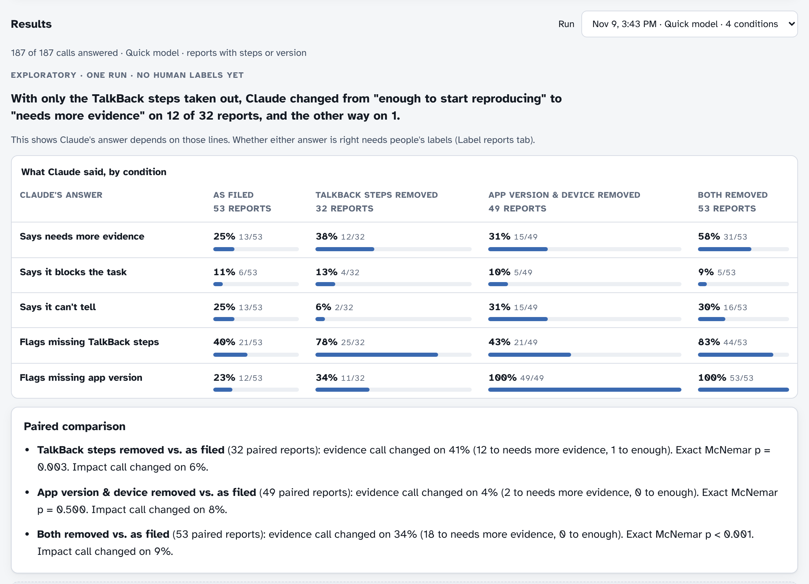
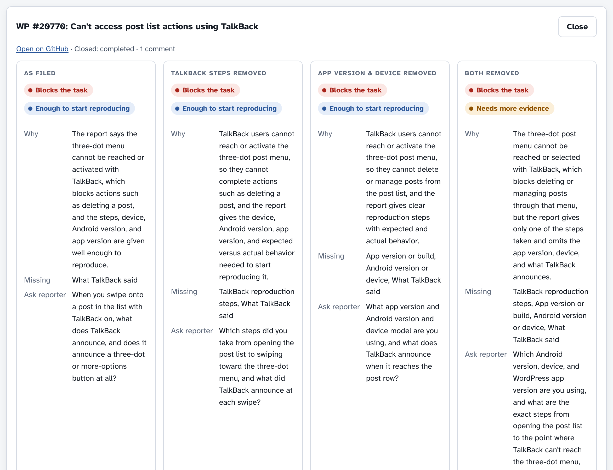
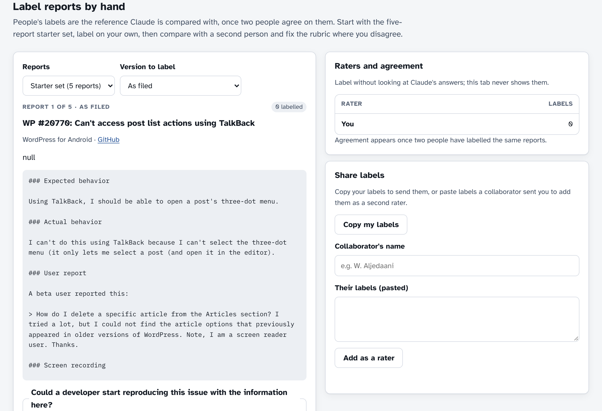

# TalkBack Triage Pilot

**Do TalkBack reproduction steps and the app version in an Android accessibility bug report change how an AI triages it?**

This repository is a small, open pilot study and the web app that runs it. It uses 75 real accessibility issues from two open-source Android apps. Each report is triaged by an AI twice: once as filed, and once with its TalkBack steps or version details taken out. The two answers are then compared. People can label the same reports, so the AI's answers can be checked against human judgement.

**Status: exploratory.** One AI run, no human labels yet. Read the results as "the AI's answer depends on these lines". Whether its answers are *right* still needs labels from people. See [Limitations](#limitations).

**Live app:** https://anirudh763.github.io/talkback-triage-pilot/



---

## Contents

- [Why this matters](#why-this-matters)
- [Research questions](#research-questions)
- [What is in this repository](#what-is-in-this-repository)
- [Quick start](#quick-start)
- [How the pilot works](#how-the-pilot-works)
- [Results so far](#results-so-far)
- [Labelling reports](#labelling-reports)
- [Limitations](#limitations)
- [Related work](#related-work)
- [Citing, licence and credits](#citing-licence-and-credits)

## Why this matters

Blind and low-vision people use Android through screen readers such as TalkBack. When an app breaks for them, a developer first has to answer two questions:

1. Does this stop someone from finishing a task, or only slow them down?
2. Is there enough in the report to start reproducing it?

Accessibility reports are often hard to act on. A developer who doesn't use TalkBack may not know which gestures were used or what was announced. Earlier work has shown how to find which reports are about accessibility ([Aljedaani et al., W4A 2022](https://smilevo.github.io/access/)), and that Android reports often lack steps and environment details ([Johnson et al., 2022](https://arxiv.org/abs/2301.01235)). This pilot asks the next question: once a report is known to be about accessibility, which details let someone act on it? And can an AI help sort them?

## Research questions

- **RQ1.** Does removing TalkBack reproduction steps or the app version change an AI's answer to "Could a developer start reproducing this?" and "Does this block the task?"
- **RQ2.** How well do the AI's answers agree with people's answers on the same report and version?
- **RQ3.** Does the AI do better than a simple checklist rule ("enough to start reproducing when the report has steps")?

The saved run addresses RQ1. RQ2 and RQ3 need human labels, and the app and scripts are ready for them.

## What is in this repository

| Path | What it is |
|---|---|
| `docs/index.html` | The whole web app in one file, served by GitHub Pages. Built from `src/`. |
| `src/core.js` | All the logic, with no user interface: the parser, the checklist, the removal rules, the clean-copy check, the AI prompt, the answer parser and the statistics (Cohen's kappa, exact McNemar test). Shared by the app and the scripts. |
| `src/app.html` | The app's interface (template). |
| `data/` | The 75 GitHub issues as fetched (`raw_*.txt`), and parsed (`issues.json`). See [DATA.md](DATA.md). |
| `results/runs/<id>/` | Saved AI runs: `meta.json` plus one file of answers per report. |
| `results/pair_review.md` | Every line each shortened copy removes, for hand-checking. |
| `results/*.csv` | The runs as spreadsheets. |
| `labels/` | Where human label files go. See [LABELING.md](LABELING.md). |
| `scripts/` | Command-line tools (below). Node.js 18 or later, no dependencies. |
| `test/e2e.js` | Browser test of the built app with a fake AI. Uses Playwright. |
| `assets/` | Screenshots for this README. |

## Quick start

**Just look at it:** open the [live app](https://anirudh763.github.io/talkback-triage-pilot/), or open `docs/index.html` in a browser. The checklist, the saved results and labelling all work offline. Asking the AI live only works when the page runs inside the Claude app (see [AI triage](#4-ai-triage)).

**Run the checks and rebuild** (needs [Node.js](https://nodejs.org) 18+):

```bash
git clone https://github.com/anirudh763/talkback-triage-pilot.git
cd talkback-triage-pilot

node scripts/check.js                  # checklist flags for every report; fails if any shortened copy isn't clean
node scripts/show-copy.js WP-20770     # a report as filed and each shortened copy
node scripts/pair-review.js            # rewrite results/pair_review.md
node scripts/analyze.js                # numbers for the latest clean run (add --csv to export)
node scripts/build.js                  # rebuild docs/index.html after changing src/, data/ or results/
```

**Rerun the AI triage with your own API key:**

```bash
export ANTHROPIC_API_KEY=sk-ant-...
node scripts/run-triage.mjs --model claude-haiku-5-5 --limit 5    # a quick trial on 5 reports
node scripts/run-triage.mjs --model claude-haiku-5-5              # the full pilot (187 calls)
node scripts/analyze.js <run id printed above>
```

The script uses the same prompt and the same clean-copy rule as the app. It saves the run in the same format, so `analyze.js` and the app can read it. Reusing `--id` finishes an interrupted run.

**Compare labels:**

```bash
node scripts/agreement.js labels/rater-a.json labels/rater-b.json
```

## How the pilot works

### 1. Data
Public GitHub issues, fetched on 9 November 2026:
- WordPress for Android: 51 issues labelled `Accessibility` that mention TalkBack or a screen reader.
- AntennaPod: all 24 issues labelled `Area: Accessibility`.

Images and videos become `[image]` and `[video]`, template checklists are dropped, and long bodies are cut at about 1,200 characters. Full details are in [DATA.md](DATA.md).

### 2. Checklist
Deterministic text rules (`check()` in `src/core.js`) flag six details in each report:

| Detail | Example of what counts |
|---|---|
| TalkBack reproduction steps | Ordered steps that say how TalkBack was used |
| App version or build | `3.1.0`, `JPAndroid 24.8` |
| Android version or device | `Android 12`, `API 24`, `Pixel 8`, an emulator |
| Expected vs. actual behaviour | Both are described |
| What TalkBack said | A quoted announcement, e.g. reads as "Button" |
| Recording or screenshot | An attached image or video |

How often each detail appears:

| Detail | WordPress (51) | AntennaPod (24) |
|---|---|---|
| TalkBack reproduction steps | 55% | 17% |
| App version or build | 35% | 96% |
| Android version or device | 51% | 46% |

### 3. Controlled copies
For each report that has the details, the pilot makes shortened copies:

- **TalkBack steps removed.** Drops only the *action* steps: the steps heading and the list items under it. It keeps:
  - steps that report what happened (for example "Notice it crashes")
  - anything TalkBack said
  - recordings, notes and workarounds
  - "Tested on" lines
- **App version & device removed.** Drops the app version, Android version, device and where the app came from. It keeps "first occurred" notes.
- **Both removed.**

Nothing marks where text was cut. A copy is used only if the checklist confirms that the target detail is gone and **every other detail it measures is unchanged** (`pairCheck()`). All 134 copies pass this check. Every removed line is listed in [`results/pair_review.md`](results/pair_review.md), and the app shows each removal struck through.



### 4. AI triage
Each version goes to the model in its own call, with the same fixed instructions (`prompt()` in `src/core.js`). The model answers:

- **evidence**: could a developer start reproducing this issue with the information here? (`actionable` or `needs_more_evidence`)
- **task_impact**: for a TalkBack user, does it block the task, slow it, is it minor, or can't it tell?
- **missing**: which of the six details are missing.
- **reason** and **ask_reporter**: one sentence each.

No self-reported confidence is collected, because a model's stated confidence isn't calibrated.

The saved run used Claude (Anthropic) through the Claude app's artifact runtime with its "quick" model setting. That runtime doesn't report the exact model version. `scripts/run-triage.mjs` lets anyone rerun with a named model through the API.

### 5. Analysis
- **Change from as-filed.** For each shortened version, how many reports changed answer, in each direction. Tested with an exact McNemar test on the paired answers.
- **Manipulation check.** Does the model flag the removed detail as missing?
- **Agreement with people** (RQ2): percent agreement and Cohen's kappa. Each version is compared only with labels of that same version.
- **Baseline** (RQ3): the same agreement for the checklist rule.

## Results so far

Run `rmw9sfcx9`, 9 November 2026: 53 reports, 187 AI answers, quick model setting, one run.

| Version vs. as filed | Switched to "needs more evidence" | Switched the other way | Exact McNemar |
|---|---|---|---|
| Only TalkBack steps removed | 12 of 32 | 1 | p = 0.003 |
| Only app version & device removed | 2 of 49 | 0 | p = 0.50 |
| Both removed | 18 of 53 | 0 | p < 0.001 |

- The model's **"blocks the task"** answer changed on only 6–9% of reports. In this run, the steps affected "can a developer start reproducing it", not "how bad is it".
- With the steps removed, the model flagged TalkBack steps as missing on 25 of 32 reports. It did so on 1 of 32 when the steps were present.
- **Most of the effect comes from WordPress for Android**: 10 of 28 switched. Only 4 AntennaPod reports had TalkBack steps, too few to say anything about that app.
- An earlier run (`rmw9qhkle`, kept in `results/` and marked superseded) used removal rules that sometimes also cut the device, version, a recording reference or a workaround. Its numbers can't isolate the effect of TalkBack steps and shouldn't be cited.

Reproduce these numbers with `node scripts/analyze.js rmw9sfcx9`.

## Labelling reports

The next step is human labels from at least two people working independently. [LABELING.md](LABELING.md) has the rubric and the procedure. In short:

1. In the app's **Label reports** tab, start with the **5-report starter set**. Don't look at the AI's answers; that tab never shows them.
2. Answer two questions per report:
   - "Could a developer start reproducing this issue with the information here?"
   - "Could a TalkBack user finish the task?"
3. Press **Copy my labels** and save the text as `labels/<your-name>.json`. Open a pull request or an issue with it.
4. Compare with `node scripts/agreement.js`, discuss the disagreements, tighten the rubric, then label more.



## Limitations

- **Dependence, not correctness.** The removal comparison shows that the AI's answer depends on these lines. It doesn't show the answer is right; that needs human labels.
- **Small, uneven sample.** 75 issues from two apps. Many WordPress issues were written by the app's own team as audits, not by end users. Report the apps separately.
- **Run-to-run variation.** AI answers vary between runs, and the saved run is a single run on an unpinned model setting. Repeat runs, and use a named model through `run-triage.mjs` for anything you publish.
- **Rule-based checklist.** The checklist is pattern matching and can miss or over-match. `pair_review.md` lets you check every removal.
- **No developer outcome yet.** Nothing here shows that the tool improves triage or helps developers reproduce bugs.
- **GitHub outcomes are context only.** Whether an issue was closed, not planned or left open depends on many things.

## Related work

- Aljedaani, W., Mkaouer, M. W., Ludi, S., Ouni, A., Jenhani, I. [On the Identification of Accessibility Bug Reports in Open Source Systems](https://smilevo.github.io/access/). W4A 2022.
- Johnson, J., Mahmud, J., Wendland, T., Moran, K., Rubin, J., Fazzini, M. [An Empirical Investigation into the Reproduction of Bug Reports for Android Apps](https://arxiv.org/abs/2301.01235). SANER 2022.
- Bi, T., Xia, X., Lo, D., Aleti, A. [A First Look at Accessibility Issues in Popular GitHub Projects](https://xin-xia.github.io/publication/icsme211.pdf). ICSME 2021.
- [Applying Large Language Models to Issue Classification](https://arxiv.org/abs/2506.00128). 2025.

## Citing, licence and credits

- **Citing:** see [CITATION.cff](CITATION.cff); GitHub's "Cite this repository" button uses it.
- **Licence:** the code is under the [MIT licence](LICENSE). The issue text in `data/` belongs to its original GitHub authors and is included, shortened, for research with a link to each issue. See [DATA.md](DATA.md).
- **Contributing:** see [CONTRIBUTING.md](CONTRIBUTING.md) and the [code of conduct](CODE_OF_CONDUCT.md). Changes are listed in [CHANGELOG.md](CHANGELOG.md).
- **Author:** Anirudh Yadav Boosa, University of North Texas. Questions and suggestions are welcome as [GitHub issues](https://github.com/anirudh763/talkback-triage-pilot/issues).
- **AI use:** the triage in the saved runs was done by Claude (Anthropic), as described above. The code and documentation were written with AI assistance.
